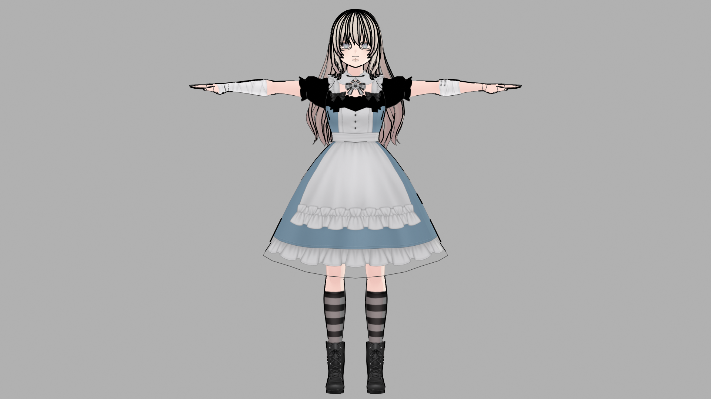
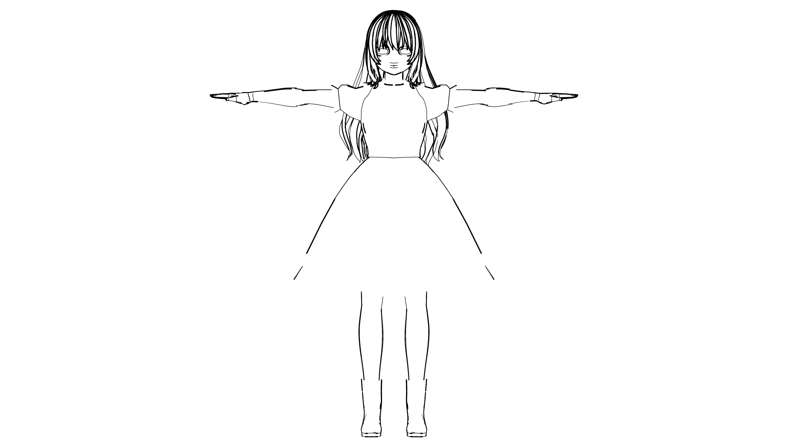
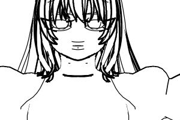

# LineForge

[](https://github.com/Toobe53/lineforge/actions/workflows/build.yml)
[](https://github.com/Toobe53/lineforge/releases)

Line-art rendering for **Blender 5.2**, built on the same ideas as Pencil+ 4 Line:
a native CPU line renderer driven by a node tree of *line sets*, composited over the
beauty render — entirely inside the Blender process, no external render app.

Downloads: [latest release](https://github.com/Toobe53/lineforge/releases/latest) —
one zip with the native core for **Windows x64, Linux x64 and macOS (arm64)**, all three
compiled by the `build.yml` CI workflow.



*Line pass composited over an EEVEE render (1920×1080, 4 line sets, 2× supersampling).*

| Line pass only | 1:1 crop |
| --- | --- |
|  |  |

* Native core: C++17 + pybind11 (`lineforge_core.pyd`), CPU G-buffer + capsule raster.
* Five line types: outline/silhouette, crease, mesh border, material boundary, object intersection.
* Per-line-set style: width (screen or world space), colour, taper in/out, random width, distance fade, brush.
* Hidden lines: occluded parts of every line set can be drawn as a translucent, thinner ghost
  (`Hidden Lines` / `Hidden Alpha` / `Hidden Width` on the scene settings).
* Brush profiles: Solid, Ink, Taper, Calligraphy, Zipper (plus width/alpha modulation and random phase).
* Viewport preview overlay (camera view), F12 auto-render of the line pass, automatic compositing.
* **Render Line Art PNG** operator: renders the beauty and the line pass and merges them itself
  (display-space straight-alpha over), no compositor node group involved — the reliable way to
  get a finished image, including in background mode.
* **Exclude Objects**: comma separated object name substrings left out of the pass, for helper shells and proxies.
* **See-through faces are skipped** (`Skip See-through Faces`, `Alpha Cutoff`): a triangle whose material drives
  Principled *Alpha* from an image is sampled at its UV centroid, and faces below the cutoff are left out of the
  G-buffer and the line pass. Without it, sheer cloth, eyelash cards and garment layers that the render shows as
  invisible would still be outlined as if they were opaque solids.
* Inverted-hull outline materials (names containing `outline`) and `MToon Outline` geometry-node shells are skipped
  automatically (`Skip Outline Shells`) so they do not occlude the real surface.
* **Supersampling** (1-4x): the line pass is rasterised at N times the output size and box-filtered down, which removes staircase artefacts on thin or steep lines. Default 2; raise to 3-4 for stills, drop to 1 for fast viewport previews.
* **Orthographic cameras** are supported (true clip-space `w` and view-space depth, not a perspective approximation).
  With ortho cameras, *Ortho Width Falloff* switches world-space widths from one constant screen
  width to distance-scaled widths (nearer geometry draws thicker), matching the perspective look.
* **Failures are messages, not tracebacks**: geometry/camera/core problems raise `LineForgeError`, which the operators report in the status bar and in the *Last Error* box; *Check Native Core* reports the loaded binary, its platform tag and the exact load error.
* **Portable build**: one zip contains `bin/<platform_tag>/lineforge_core.<ext>`; the loader picks the tag for the running Blender and lists the platform + fix in the error if no binary matches. Prebuilt binaries ship for Windows x64; Linux/macOS build from source with `tools/build.py` or CMake.
* Licence: **GPL-2.0-or-later**.

## Requirements

* Blender **5.2.x**; the add-on targets the CPython 3.13 that ships with Blender. Prebuilt native core: Windows x64.
* Other platforms: build the core from source (see *Build*) — the Python add-on and the node tree are platform independent.
* To build the native core on Windows: the portable toolchain from `tools/get-toolchain.ps1`
  (w64devkit GCC + CPython 3.13 headers + pybind11 headers). No Visual Studio needed.

## Install (binary)

1. Build or obtain the native core for your platform; it lives in `addon/lineforge/bin/<platform_tag>/`
   (Windows x64 ships as `bin/win64/lineforge_core.pyd`).
2. Zip the `addon/lineforge` folder so the archive contains `lineforge/__init__.py` at its root.
3. Blender → *Edit › Preferences › Add-ons › Install…* → pick the zip → enable **LineForge**.
4. Sidebar → **LineForge** tab; the top box shows the core status. If it is red, press *Check Native Core*
   to see the platform tag and the exact load error.

## Quick start

1. Open a scene with a camera. In 3D Viewport press `N` → **LineForge** tab → *Create Node Tree*.
   (Or run the operator `lf.create_tree` from the operator search.)
2. The tree `LineForge` is created with four line sets wired to the output:
   `Outline` (object), `Crease`, `Border`, `Intersection`.
3. Press **Render Line Pass** (or F12 with *Auto Render on F12* enabled) to render the line pass,
   write it to the `LineForge Pass` image and composite it over the render.
4. For a finished image without touching Blender's compositor, use **Render Line Art PNG**
   (`lf.render_composite`): it renders the beauty with the Standard view transform, renders the
   line pass, and writes a single merged PNG. This is the path validated on the VRM demo scene.
5. Open the tree in the Shader/Compositor editor (or the *Open Node Tree* button) to tweak widths,
   colours, taper, brushes, crease angle and per-set object filters.

## Demo

`docs/line_pass_1080p.png` — line pass rendered by the native core from a real VRM scene
(`C:\PencilPlus\vrm_pcl_line5.blend`: 70,794 triangles, 55 meshes, 1920×1080):
≈1500 polylines / 20,000 segments in **~0.5 s** core time at supersampling 2 (≈2.5 s including depsgraph extraction).

`docs/composite_1080p.png` — the same pass alpha-over the EEVEE beauty render.

Reproduce with:

```powershell
blender -b --factory-startup --python tests/blender_demo_manual.py
```

## How it works

```
Blender depsgraph ──► scene_extract.py ──► flat numpy buffers (verts/tris/normals/mats/objs/edges)
                                              │
                                              ▼
                          lineforge_core.render_scene(scene, settings)   [C++, CPU]
                                              │
                     ┌────────────────────────┴─────────────────────────┐
                     ▼                                                  ▼
              G-buffer raster (depth,     edge classification (silhouette, crease,
              face id, object id)         border, material) + intersection walk
                     └────────────────────────┬─────────────────────────┘
                                              ▼
                          capsule raster of polylines with depth test, taper,
                          brush modulation, distance fade → premultiplied RGBA
                                              │
                                              ▼
                     renderer.py: alpha-over multiple passes, write image,
                     compositor wiring (Render Layers ▸ Alpha Over ▸ Composite)
```

* **Occlusion** — every stroke pixel is depth-tested against the triangle G-buffer, so hidden
  edges are removed exactly (no object-level hacks).
* **Silhouettes** — an edge is a silhouette when the two adjacent triangles face opposite sides of
  the camera.
* **Creases** — angle between adjacent triangle normals below the crease threshold.
* **Intersections** — pixels whose neighbouring object ids differ and whose depths are continuous,
  traced into polylines (RDP + Chaikin), drawn without depth test.
* **Anti-aliasing** — analytic capsule distance coverage, so strokes stay crisp at any width.
* **Hidden lines** — a second capsule pass runs with a larger depth bias and keeps only the pixels
  that fail the depth test, composited *under* the visible strokes with its own alpha and width.

## Project layout

```
addon/lineforge/        Blender add-on (Python)
  __init__.py           registration, handlers, F12 hook
  nodes.py              node tree: LFLineSetNode, LFOutputNode, LFNodeTree
  properties.py         Scene.lf settings
  scene_extract.py      depsgraph → flat buffers
  renderer.py           passes, compositing, image writing
  overlay.py            3D viewport preview
  operators.py          lf.* operators
  panels.py             sidebar UI
  bin/<platform_tag>/   native core (win64/win-arm64/linux-x64/linux-arm64/macos-arm64/macos-x64)
src/                    C++ core (core.hpp, core.cpp) + pybind11 bindings (module.cpp)
tests/                  headless test scripts: smoke_core, test_style (taper/brush/random/fade/
                        hidden), test_overlay, blender_addon_test, blender_scene_pass,
                        blender_composite_op, blender_aa_test, blender_ortho_test,
                        blender_transparent_test, blender_robustness, blender_install_test
tools/get-toolchain.ps1 portable toolchain bootstrap (Windows)
tools/build.py          cross-platform core build (Python 3 + any C++17 compiler or MSVC)
CMakeLists.txt          alternative CMake build with pybind11
build.ps1               builds the native core and copies it into the add-on
package.ps1             builds dist/lineforge-<version>.zip
```

## Build

```powershell
pwsh -File .\tools\get-toolchain.ps1    # once: w64devkit + CPython headers + pybind11
pwsh -File .\build.ps1                  # compiles src/*.cpp -> addon/lineforge/bin/win64/lineforge_core.pyd
```

The build links against `python313.lib` from the CPython NuGet package and is self-contained
(`-static`), so the `.pyd` only depends on `python313.dll` (provided by Blender).

Cross-platform alternative (Linux/macOS, or if you prefer CMake):

```bash
python3 tools/build.py            # auto-detects python3 + pybind11 + compiler, writes build/<tag>/
cmake -B build -DPython_EXECUTABLE=$(which python3) && cmake --build build
```

`tools/build.py` accepts `--cxx`, `--python-home`, `--pybind11`, `--clean`, `--debug`, `--no-copy`;
it never needs Blender and copies the result to `addon/lineforge/bin/<platform_tag>/`.
On Windows it uses `g++`/`clang++` when available and otherwise the Visual Studio toolset through
`vswhere`/`vcvars64.bat`.

Packaging is done by `tools/package.py` (stdlib only, same archive on Windows, Linux, macOS and CI):

```bash
python3 tools/package.py                      # dist/lineforge-<version>.zip
python3 tools/package.py --version 0.2.0      # override the bl_info version
```

`.github/workflows/build.yml` builds the core on Ubuntu, Windows and macOS, merges the three
`bin/<tag>/` binaries into one zip and publishes it as a release asset for `v*` tags.

## Limitations / roadmap

* Blender's compositor path (`Auto Composite`) is experimental: in complex production files
  prefer rendering the pass to an image (`Render Line Pass` with *Save Pass*) and alpha-over it
  yourself — `tests/blender_demo_manual.py` shows the deterministic numpy composite.
* Prebuilt binaries are Windows x64 only; Linux and macOS must build from source (`tools/build.py`).
* Double-layered garments (inner + outer cloth shell) still outline both layers when both are opaque;
  filter the helper object with *Exclude Objects* if the extra ring is not wanted. Semi-transparent
  layers are handled by *Skip See-through Faces*.
* Hidden lines are a translucent ghost of occluded strokes; they do not add occluded edges that
  were never emitted as line primitives (e.g. creases of a fully hidden part when crease is off).
* Viewport overlay is camera-view only and draws the cached line pass (no incremental redraw).
  The GPU draw path cannot run headless; its geometry/scale helpers are covered by `tests/test_overlay.py`.
* Intersection lines are derived from the G-buffer, so very thin pairs of surfaces can fragment.
* No GPU backend; the CPU raster is aimed at production stills, not interactive frame rates.

## Licence

GPL-2.0-or-later. See `LICENSE`. This project is an independent implementation inspired by the
feature set of Pencil+ 4 Line; it contains no code from PSOTHOUSE's products.
