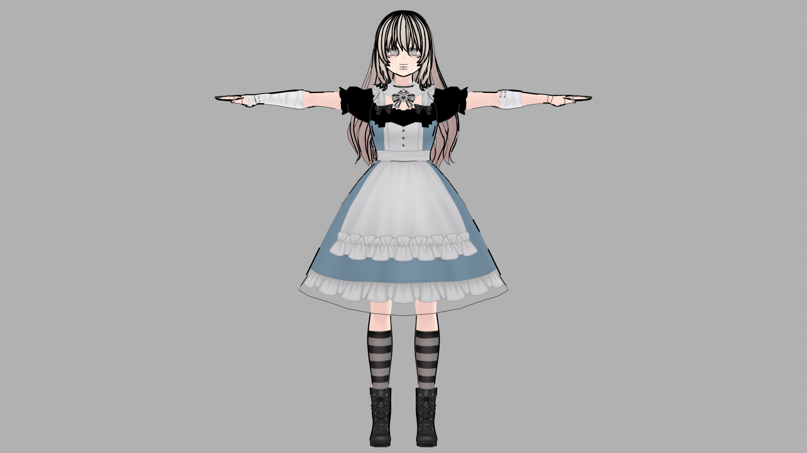

# LineForge 使用说明（中文）

[](https://github.com/Toobe53/lineforge/actions/workflows/build.yml)
[](https://github.com/Toobe53/lineforge/releases)

下载：[最新 release](https://github.com/Toobe53/lineforge/releases/latest) —— 一个 zip 里打包了
Windows x64、Linux x64、macOS (arm64) 三份原生内核，全部由 `build.yml` CI 编译。



*线稿合成在 EEVEE 渲染之上（1920×1080，4 个线集，2× 超采样）；`docs/line_pass_1080p.png` 是纯线稿，`docs/crop_hair_1to1.png` 是 1:1 局部。*

Blender 5.2 的线稿渲染插件：C++ 原生内核（pybind11，CPU 光栅）+ Python 节点树界面，
全部在 Blender 进程内运行，不依赖任何外部渲染程序。许可证 GPL-2.0-or-later。

线稿支持超采样（1–4×，默认 2）：在 N 倍分辨率下光栅化后盒式降采样，消除细线与陡斜线的锯齿；静帧可调到 3–4，视口预览可降到 1。

**跳过透明面**（`Skip See-through Faces` + `Alpha Cutoff`）：材质用贴图驱动 Principled *Alpha* 时，
在 7 个重心采样点上取覆盖率（均值与峰值各半），低于阈值的面，不进入 G-buffer、也不出线。`Keep Names` 可列出永不跳过的对象/材质子串（如 `eyelash, glasses`）。否则半透明薄纱、睫毛片、
多层衣料在渲染里看不见，却会被当成不透明实体描出轮廓（VRM 裙子外那圈"鬼影锥"就是它）。

**跳过描边壳**（`Skip Outline Shells`，默认开）：材质名含 `outline` 的反向壳，以及 `MToon Outline (...)`
几何节点修改器生成的沿法线外推壳，都从提取时排除，避免遮挡真实表面。

**每线集过滤**（LineSet 节点上的 `Objects` / `Materials` / `Skip Objects` / `Skip Materials`）：逗号分隔的
通配符列表，一个节点树里可以让某个线集只画脸、只画某件衣服，或排除某个代理物体及其交线。

**毛发曲线**：Blender 5.2 的 `CURVES` 对象直接按自身的点与半径画成锥形胶囊（`Hair Curves`、`Hair Width`、
`Max Strands`、`Points per Strand`），不三角化、也不占 G-buffer。

**线型与笔刷贴图**：每个线集可选 `Solid / Dash / Dot` 并设置周期与占空比；另有程序化 `Charcoal`、
`Pencil`、`Ink` 纹理沿弧长调制线宽，以及线集级 `Simplify` 覆盖全局简化阈值。

**动画快照缓存**：提取结果按帧缓存，由 depsgraph 回调加一个廉价的几何指纹（脚本直接改网格数据也不会拿到旧线）
失效；同一帧第二次渲染完全跳过提取。

**交线质量**：交线像素串成链后先桥接 1–3 px 的断口，再做 RDP + 两次 Chaikin 平滑，衣料接缝是连续曲线而不是点状台阶。

**视口覆盖层缓存**：覆盖层的三角条带与 GPU batch 只在线数据或区域尺寸变化时重建，缩放/旋转相机仅重绘已有 batch。

支持正交相机（用真实 clip 空间 w 与视图空间深度，不是透视近似）。正交相机下新增
**Ortho Width Falloff** 开关：关闭时世界空间线宽折算成固定屏幕像素（平行投影语义），
打开时保留 `focal / depth` 缩放，近处几何画得更粗。

构建与打包：Windows 用 `build.ps1` / `package.ps1`；跨平台用 `tools/build.py`（支持 g++/clang++/
MSVC via vswhere）与 `tools/package.py`（纯标准库，和 CI 产出同一个 zip）。
`.github/workflows/build.yml` 在 Ubuntu/Windows/macOS 三平台编译内核并合成单 zip，打 `v*` tag 时自动发 release。

## 安装

1. 用现成的包：`dist/lineforge-0.4.0.zip`（已包含 Windows x64 编译好的 `bin/win64/lineforge_core.pyd`）。
2. Blender → 编辑 › 偏好设置 › 插件 › 安装… → 选中该 zip → 勾选启用 **LineForge**。
3. 本机已安装并启用（`%APPDATA%\Blender Foundation\Blender\5.2\scripts\addons\lineforge`）。
4. 侧栏 **LineForge** 页签顶部显示内核状态；红色时点 *Check Native Core* 会显示平台标签与具体加载错误。

从源码构建（Windows）：

```powershell
pwsh -File C:\LineForge\tools\get-toolchain.ps1   # 首次：下载 w64devkit + CPython 3.13 头 + pybind11
pwsh -File C:\LineForge\build.ps1                 # 编译 src/*.cpp → addon/lineforge/bin/win64/lineforge_core.pyd
pwsh -File C:\LineForge\package.ps1               # 重新打包 dist/lineforge-0.4.0.zip
```

Linux / macOS 用跨平台脚本或 CMake 自行构建（无需 Blender）：

```bash
python3 tools/build.py        # 自动找 python3 头、pybind11、编译器；输出 build/<平台标签>/
cmake -B build -DPython_EXECUTABLE=$(which python3) && cmake --build build
```

插件包结构是单 zip + `bin/<平台标签>/`（win64 / win-arm64 / linux-x64 / linux-arm64 / macos-arm64 / macos-x64），加载器按运行平台选目录；找不到对应二进制时会在 UI 里报出平台标签与修复方法。

## 快速上手

1. 打开带相机的场景，3D 视图按 `N` → **LineForge** 页签 → *Create Node Tree*。
   会自动建好 `LineForge` 节点树：Outline（轮廓）、Crease（折痕）、Border（网格边界）、
   Intersection（物体交线）四个线集，全部接到输出节点。
2. 在 Shader 编辑器（或 N 面板的 *Open Node Tree*）里编辑：每个 LineSet 节点有
   类型、宽度、屏幕/世界空间、颜色、taper、随机宽度、距离衰减、笔刷预设等参数；
   输出节点控制分辨率倍率、材质颜色、简化阈值、深度偏移。
3. 渲染：点 **Render Line Pass**（或勾 *Auto Render on F12* 后按 F12）。若要一张不经合成器节点的终图，点 **Render Line Art PNG**（`lf.render_composite`）：它会用 Standard 视图变换渲 beauty、再渲线稿并自行合成，后台模式同样可用。
   线稿会写入 `LineForge Pass` 图像并合成到渲染结果上。
4. 视口预览：相机视图下打开覆盖层（*Toggle Overlay*），会叠加缓存的线稿。

## 五种线

| 类型 | 含义 |
|---|---|
| OUTLINE | 物体外轮廓（相邻面朝向相反） |
| CREASE | 折痕（相邻面法线夹角超过阈值） |
| BORDER | 网格开放边界 |
| MATERIAL | 不同材质之间的边界 |
| INTERSECTION | 两个物体表面相交处（由 G-buffer 物体 id 追踪） |

## 隐藏线

场景设置里打开 *Hidden Lines*，被遮挡的笔画会以更细、更透明的"幽灵线"画在可见线下方，
透明度/宽度分别由 *Hidden Alpha* / *Hidden Width* 控制。

## 多 pass（AOV）输出

*Passes (AOV)* 折叠框里可分别打开 **Hidden Pass**（只含被遮挡笔画）与 **Depth Pass**（视空间深度）。
「Save Passes」会一次写出 `<base>_lines.png`、`<base>_hidden.png`、`<base>_depth.exr`；合成器里可直接用
`LineForge Hidden` / `LineForge Depth` 两个图像数据块。深度是场景单位下的视空间距离，没打到几何的地方为 0。

## 图像笔刷

线集节点的 *Image Brush* 折叠框可以选任意已加载图像作为笔宽 profile：通道（LUMA/ALPHA/RED/GREEN/BLUE）、
反相、幅度、重复次数。图像会被重采样成 256 档 profile 沿线应用，扫描的铅笔/墨线贴图可以直接用，不影响内置预设。

## 背面剔除与提速

*Backface Culling*（默认 Cull Back）只作用于深度缓冲：线型判定完全不变，但光栅量减半。
内核另外做了 4 像素一批的 SSE2 三角形光栅、笔画与合成的脏矩形遍历，1080p 演示从超采样 1 的 175 ms 降到 118 ms、
超采样 2 的 503 ms 降到 399 ms。

## 已知限制

- Blender 内置合成器路径（*Composite Into Render*）仍是实验性的；复杂生产文件建议
  「渲染 pass 图 + 自己 alpha-over」，`tests/blender_demo_manual.py` 是确定性做法。
- 双层布料模型（如 VRM）可能多出一圈内壳轮廓，用线集的 COLLECTION/OBJECT 过滤规避。
- 交线由 G-buffer 推得，极薄的相交面可能断成多段。
- 纯 CPU 光栅，定位是静帧产出，不是实时视口。
- 视口覆盖层只画缓存的线稿，无 GPU 环境下只验证了几何辅助函数。

## 性能参考

`vrm_pcl_line5.blend`（55 网格 / 70,794 三角 / 116,144 边）在 1920×1080、4 个线集下：
约 1540 条折线、33,000 段；超采样 2 下内核 **约 0.40 s**（深度 233 ms、笔画 50 ms、合成 116 ms），含 depsgraph 提取约 2.4 s（同一帧第二次渲染命中快照缓存，只付内核时间）。
