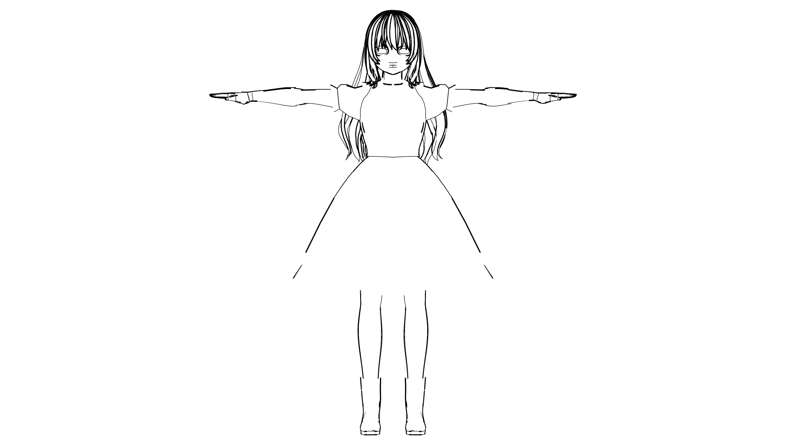

# LineForge — User Tutorial (v0.4.0)

A step-by-step guide to installing LineForge, producing your first line pass, styling it and taking it into
compositing. 中文版：[TUTORIAL.zh.md](TUTORIAL.zh.md).

LineForge is a **CPU line-art renderer** for Blender 5.2. It reads the scene geometry, finds five kinds of
edges (silhouette, crease, mesh border, material boundary, object intersection) and rasterises them into a
transparent line pass that you composite over your EEVEE / Cycles beauty render.



1080p, 4 line sets, supersampling 2: **≈0.40 s** of core time (≈2.4 s including depsgraph extraction; a cached
frame pays the core time only).

---

## 1. Install

| Item | Requirement |
|---|---|
| Blender | **5.2.x** (uses Blender's bundled CPython 3.13) |
| Windows x64 | Prebuilt core ships in the zip |
| Linux / macOS | Build the core from source (`tools/build.py` or CMake); the Python add-on is portable |

1. Download `lineforge-<version>.zip` from the [latest release](https://github.com/Toobe53/lineforge/releases/latest)
   (do **not** unzip it).
2. `Edit` → `Preferences` → `Add-ons` → `Install…` → pick the zip.
3. Enable **LineForge** (`Render` category).
4. In the 3D Viewport press `N` and open the **LineForge** tab.

If the panel shows `Native core not available`, the box lists the platform tag and the loader error;
`Check Native Core` (`F3` search) re-probes and reports the loaded binary and version.

---

## 2. Where everything lives

**3D Viewport → N panel → LineForge tab**

| Section | Purpose |
|---|---|
| Enable LineForge | Master switch |
| Preview Lines / Render With LineForge / Render Line Art PNG / Save Line Pass PNG | Output commands (see §5) |
| Passes (AOV) | Extra hidden-line and depth outputs |
| Line Sets | The line sets that are linked to the output, editable in place |
| Settings | Global parameters (scale, supersampling, culling, crease angle, filters, transparency) |
| Hair Curves | Strand rendering for Blender 5.2 hair curves |
| Last Error / Last Render | Failure reasons and the statistics of the last render |

**Node editor** — switch the editor's tree type to **LineForge** (or press `Nodes` in the panel). The tree holds
`LineForge Output` plus any number of `Line Set` nodes. Only line sets **linked to the output** are rendered;
their vertical order defines the draw order. Select a line set and press `N` for the full style/brush/pattern/
filter groups.

---

## 3. First line pass in five steps

1. Open a scene, add a camera, press Numpad `0` for camera view.
2. `Create LineForge Tree` — builds the tree with four default line sets: *Outline* (3 px), *Crease* (1.6 px),
   *Border* (1.2 px), *Intersection* (2 px), all black and linked.
3. `Preview Lines` — renders the line pass only and shows it in the Image Editor (datablock `LineForge Pass`).
4. `Render Line Art PNG` — renders beauty + line pass and merges them into one PNG without the compositor
   (the most reliable path, also in background mode).
5. Or press `F12`: with `Render On F12` / `Composite Into Render` on, the line pass is rendered and composited
   into the render result.

The line pass is **premultiplied alpha**; a plain preview shows black lines over black. Composite it or use the
merged output.

---

## 4. The five line types

| Line type | Definition | Typical use |
|---|---|---|
| **Object** | Edges where the surface flips away from the camera (silhouette) | Main outline, always on |
| **Crease** | Interior edges where the dihedral angle is below the threshold (60° default) | Hard surfaces, cloth folds |
| **Border** | Open edges belonging to one triangle only | Cloth and card borders, hair cards |
| **Material** | Edges whose two triangles use different materials | Cel-shaded colour separation |
| **Intersection** | Screen-space crossing between two different objects | Hat into hair, arm against body, cloth on cloth |

Recipes: stylised characters → Object + thin Crease + Intersection; hard-surface → Object + Crease (25–35°) +
Material; sketchy look → Object with `DASH`/`Charcoal` plus some `Random Width`.

---

## 5. Parameters

### Line set — Style

| Parameter | Meaning |
|---|---|
| Width | Pixels (scene units with `World Space Width`) |
| Color | Line colour and alpha |
| Taper In / Out | Fade the ends to a point over N pixels |
| Random Width | Per-stroke width jitter (0–1) |
| Distance Fade / Fade Start | Fade strokes that are farther than *Fade Start* over *Distance Fade* |

### Line set — Brush

Presets `Solid`, `Ink`, `Taper`, `Calligraphy`, `Zipper`, with `Brush Repeat`, `Brush Width`, `Brush Alpha` and
`Random Phase`. `Image Brush` (v0.4) drives the width profile from any loaded image — channel LUMA/ALPHA/RGB,
invert, strength and repeat; the image is resampled to a 256-tap profile along each stroke.

### Line set — Pattern / Texture

`Solid / Dash / Dot` with `Period` and `Duty`; procedural `Charcoal`, `Pencil`, `Ink` width noise with
`Texture Scale`; optional per-line-set `Simplify` tolerance.

### Line set — Filters (v0.3)

Comma separated globs, applied per line set: `Objects`, `Skip Objects`, `Materials`, `Skip Materials`
(e.g. `Body*, Hair*` or `*_SKIN, *_CLOTH_01`).

### Output node

`Resolution Scale` (%), `Use Material Colors`, `Simplify` (px), `Depth Bias` (raise it when lines start to
show through surfaces).

### Scene settings

| Parameter | Default | Notes |
|---|---|---|
| Line Scale | 1.0 | Global width multiplier |
| Supersampling | 2 | Render the pass at N× then box-filter down (1 fast, 4 smooth) |
| Backface Culling | Cull Back | Depth pass only; edge detection is unaffected. Use `Off`/`Cull Front` for single-sided or reversed-winding meshes |
| Ortho Width Falloff | off | With an ortho camera, scale world-space widths by depth |
| Crease Angle | 60° | Lower = more creases |
| Intersection Tolerance | 0.01 | Raise if intersection lines break |
| Seed | 12345 | Random width, jitter and texture noise |
| Exclude Objects | – | Comma separated object-name substrings to drop |
| Skip Outline Shells | on | Temporarily disables `MToon Outline` geometry-node / inverted-hull modifiers |
| Skip See-through Faces | on | Skips faces whose material alpha is transparent at the sampled UVs |
| Alpha Cutoff | 0.5 | Transparency threshold |
| Keep Names | – | Object/material substrings that must never be skipped (e.g. `eyelash, FaceEyeline`) |
| Hair Curves / Width / Max Strands / Points per Strand | on / 1.0 / 4000 / 32 | Blender 5.2 `CURVES` rendered as tapered capsules, no triangulation |

---

## 6. Output commands

| Command | Result | When |
|---|---|---|
| Preview Lines | Line pass into an Image Editor | Tuning |
| Render With LineForge | Beauty + line pass composited into the render result | Looking at the render |
| Render Line Art PNG | Beauty + line pass merged with straight-alpha over, saved as PNG | Final images |
| Save Line Pass PNG | Line pass only | Taking it into post |

**AOV passes** — `Hidden Pass` (occluded part of every stroke) and `Depth Pass` (linear view-space depth,
0 where nothing was hit) can be saved together with `Save Passes`:

```
<base>_lines.png    premultiplied line pass
<base>_hidden.png   hidden strokes
<base>_depth.exr    linear depth
```

They are also available as the image datablocks `LineForge Hidden` and `LineForge Depth`.

---

## 7. Performance (1920×1080, 70,794 triangles, 4 line sets)

| Configuration | Core time | Breakdown |
|---|---|---|
| Supersampling 1 | 118 ms | depth 70 / strokes 19 / composite 28 |
| Supersampling 2 | 399 ms | depth 230 / strokes 50 / composite 116 |
| Including extraction (ss=2) | ≈2.4 s | ≈2.0 s extraction; cached frames skip it |

Order of savings: lower supersampling → lower resolution or `Resolution Scale` → disable unnecessary line sets
→ use per-line-set filters to render only what you need.

---

## 8. Troubleshooting

| Symptom | Fix |
|---|---|
| No lines at all | `Enable LineForge` on; a camera exists; line sets linked to the output; check `Last Error` and `Check Native Core` |
| Lines too thick/thin | `Line Scale` first, then per-set `Width` |
| Extra outline around a skirt | Keep `Skip See-through Faces` and `Skip Outline Shells` on; exclude that mesh with `Exclude Objects` or per-set `Skip Objects` |
| Occluded lines still drawn / surfaces bleed through | `Backface Culling` → `Off` (single-sided cards) or `Cull Front` (reversed winding) |
| Intersections break into pieces | Raise `Intersection Tolerance`, lower `Simplify` |
| Colours look wrong or milky | The pass is premultiplied; use `Render Line Art PNG` or unpremultiply; don't load it as `Non-Color` |
| Ortho lines don't get thicker closer | Enable `Ortho Width Falloff` |
| Eyelashes / glasses vanish | Add them to `Keep Names`, or lower `Alpha Cutoff` |
| F12 render has no lines | Ensure `Render On F12` and `Composite Into Render` are on; `Render Line Art PNG` bypasses the compositor entirely |

---

## 9. Headless usage

```python
# blender -b scene.blend --python render_lines.py
import bpy
from lineforge import renderer

scene = bpy.context.scene
if scene.lf.node_tree is None:
    bpy.ops.lf.create_tree()

renderer.render(bpy.context)
stats = renderer.last_stats()          # lines, strokes, core_ms, raster_ms, ...
renderer.save_passes(bpy.context, r"C:\out\shot.png")   # lines / hidden / depth
```

---

## 10. Version and licence

- **0.4.0**, see [CHANGELOG](../CHANGELOG.md).
- **GPL-2.0-or-later**: commercial use and modification allowed; distributed derivatives must stay open.
- Issues and ideas: [GitHub Issues](https://github.com/Toobe53/lineforge/issues).
