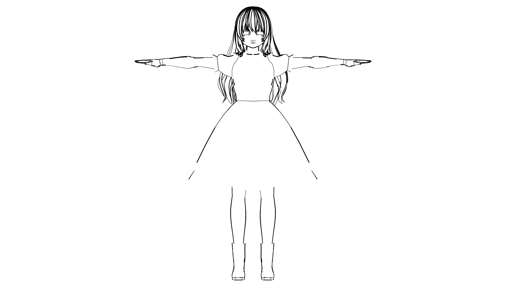

# LineForge 使用教程（v0.4.0）

面向 Blender 用户的一步步教程：装好插件、出第一张线稿、把线稿调成你要的样子、再交给合成。

---

## 0. 你会得到什么

LineForge 是一个 **CPU 线稿渲染器**：它读场景里的几何，算出五种"线"（外轮廓、折痕、网格边界、材质分界、物体交线），
再按线集（Line Set）的样式画成一张独立的透明线稿图，叠在你的 EEVEE / Cycles 渲染上。

- 纯 CPU 光栅，不依赖 GPU，服务器/无头环境也能出图；
- 线稿是**独立 pass**，后期可以单独调色、模糊、做抖动；
- 1080p / 4 个线集 / 超采样 2：内核约 **0.40 s**，含场景提取约 2.4 s（同一帧第二次渲染只付内核时间）。



---

## 1. 安装与启用

### 1.1 系统要求

| 项目 | 要求 |
|---|---|
| Blender | **5.2.x**（用 Blender 自带的 CPython 3.13） |
| 平台 | Windows x64：装包自带编译好的内核 |
| 其它平台 | Linux / macOS 需自行编译内核（`tools/build.py` 或 CMake），Python 部分通用 |

### 1.2 安装

1. 下载 [最新 Release](https://github.com/Toobe53/lineforge/releases/latest) 里的 `lineforge-<版本>.zip`（**不要解压**）。
2. Blender → `Edit` → `Preferences` → `Add-ons` → 右上角 `Install…` → 选中 zip。
3. 在列表里勾选 **LineForge**（分类 `Render`）。
4. 打开 3D 视图，按 `N` 打开侧栏，切到 **LineForge** 页签。

### 1.3 第一次自检

- 顶部勾上 **Enable LineForge**。
- 如果显示红框 `Native core not available`：说明当前平台没有对应内核，框里会写出平台标签（如 `win64`）和加载错误。
  - 用 `Check Native Core`（搜索菜单 `F3` → Check Native Core）可以重新探测，它会报告实际加载的二进制路径与版本。
- 一切正常时，按 `Create LineForge Tree` 就能开始。

> 版本对应关系：插件版本（0.4.0）与内核文件 `bin/<平台>/lineforge_core.pyd` 是同一个包，不要手动替换单个文件。

---

## 2. 界面导览

### 2.1 3D 视图 → N 面板 → LineForge

从上到下依次是：

| 区域 | 用途 |
|---|---|
| Enable LineForge | 总开关（关掉后不渲染、不覆盖） |
| Preview Lines / Render With LineForge / Render Line Art PNG / Save Line Pass PNG | 四个输出入口（见第 6 节） |
| Passes (AOV) | 额外输出「遮挡线」与「深度」两张图 |
| Line Sets | 当前参与渲染的线集列表（勾选/类型/宽度/颜色，可就地改） |
| Settings | 全局参数（缩放、超采样、背面剔除、折痕角、交线容差、种子、过滤与透明面开关） |
| Hair Curves | 毛发曲线支持 |
| Last Error / Last Render | 出错原因、上次渲染的统计 |

### 2.2 节点编辑器

线集是节点，放在一个专用的 **LineForge** 节点树里：

1. 打开任意 Node Editor；
2. 编辑器头部把树类型切到 **LineForge**（或点面板里的 `Nodes` 按钮）；
3. 你会看到 `LineForge Output` 和若干个 `Line Set` 节点。

规则很简单：**只有连到 Output 节点上的线集才会被渲染**，四个输入口按节点纵向位置从上到下依次绘制。
选中线集节点按 `N`，可以在侧栏看到完整的样式、笔刷、图案、过滤器分组。

---

## 3. 五分钟出第一张图

1. 打开你的场景，放一个相机，按小键盘 `0` 进入相机视图。
2. N 面板 → LineForge → `Create LineForge Tree`。
   它会在当前场景建好节点树并给你 **4 个默认线集**：
   - `Outline`（Object 轮廓，3 px）
   - `Crease`（折痕，1.6 px）
   - `Border`（网格边界，1.2 px）
   - `Intersection`（物体交线，2 px）
   全部是黑色、已连到 Output。
3. 点 `Preview Lines`：只渲染线稿，结果出现在 Image Editor 里（图名 `LineForge Pass`）。
4. 点 `Render Line Art PNG`：渲染 beauty + 线稿并**自己合成**成一张 PNG（推荐，不依赖合成器）。
5. 想参与正常的 F12 流程，就保持 `Render With LineForge` 或直接在 Render 面板按 F12（默认会自动挂上合成）。

> 背景全黑/全白都正常：线稿图是**预乘 alpha**，在 Image Editor 里按 `Shift+Alt+Home` 平铺看，或者直接看合成结果。

---

## 4. 五种线：什么时候用哪种

| 线型 | 含义 | 典型用法 |
|---|---|---|
| **Object**（外轮廓 / 剪影） | 朝相机方向翻转的边，即"看到的外形边" | 主线条，永远开 |
| **Crease**（折痕） | 两个面夹角小于阈值（默认 60°）的边 | 硬表面、衣物褶皱、肌肉线条 |
| **Border**（网格边界） | 只属于一个面的开边（布料边缘、卡片边缘） | 布料/纸片/头发卡片，通常细一点 |
| **Material**（材质分界） | 两侧三角形材质不同的边 | 赛璐璐风格里区分皮肤/衣服、色块边界 |
| **Intersection**（物体交线） | 两个不同物体在屏幕上互相穿过的边界 | 帽子压头发、手臂贴身体、布料叠布料 |

实拍建议：

- 卡通/动漫角色：Object + Crease（细）+ Intersection；Border 会把所有卡片边缘都画出来，先关掉看效果。
- 硬表面机械：Object + Crease（角度调到 25–35°）+ Material。
- 草图感：Object 用 `DASH` 或 `Charcoal` 纹理，Crease 关掉，再加一点 `Random Width`。

---

## 5. 调参手册

### 5.1 线集节点（选中节点按 N）

**基础**

| 参数 | 说明 |
|---|---|
| Enabled | 该线集是否参与渲染 |
| Line Type | 五种线型之一 |
| Source | `Scene`（全场景）/ `Collection`（某集合）/ `Object`（单物体） |

**Style**

| 参数 | 说明 |
|---|---|
| Width | 屏幕像素宽（`World Space Width` 打开时是场景单位宽） |
| Color | 线条颜色与透明度（默认黑） |
| Taper In / Taper Out | 两端渐细的长度（像素） |
| Random Width | 沿线随机粗细（0–1），手绘感 |
| Distance Fade / Fade Start | 超过一定深度后变淡：`Fade Start` 之后，在 `Distance Fade` 的范围内淡到 0 |

**Brush**（笔触）

| 预设 | 效果 |
|---|---|
| Solid | 实线 |
| Ink | 轻微粗细起伏，像马克笔 |
| Taper | 中间粗两头细 |
| Calligraphy | 交替粗细，像毛笔 |
| Zipper | 高频锯齿，手绘抖动 |

`Brush Repeat` 控制循环次数，`Brush Width` / `Brush Alpha` 控制调制幅度，`Random Phase` 打散相位避免整齐。

**Image Brush**（图像笔刷，v0.4 新增）

选一张图，LineForge 会把它横向重采样成 256 档宽度 profile，沿线调制笔宽：

- `Channel`：亮度 / Alpha / R / G / B；
- `Invert`：亮处变细（适合"深色=墨多"的扫描图）；
- `Image Strength`：调制强度（0 = 不生效）；
- `Image Repeat`：每 256 px 重复几次。

适合：扫描的铅笔颗粒、干刷、马克笔纹理。

**Pattern / Texture**

| 参数 | 说明 |
|---|---|
| Pattern | `Solid` / `Dash`（虚线段）/ `Dot`（点线） |
| Period / Duty | 一个循环的长度与"画出来的比例" |
| Texture | `Charcoal` / `Pencil` / `Ink`：程序化宽度扰动（Ink 偶尔断线） |
| Texture Scale | 扰动频率 |
| Override Simplify | 单独设置该线集的折线简化容差（像素） |

**Filters**（每线集独立过滤，v0.3 起）

四个逗号分隔的 glob：

- `Objects` / `Skip Objects`：按对象名保留/排除，例如 `Body*, Hair*`；
- `Materials` / `Skip Materials`：按材质名保留/排除，例如 `*_SKIN, *_CLOTH_01`。

例：只给面部画线 → 线集 `Objects` = `Face*`；想给头发单独更粗的线 → 复制一个线集，`Objects` = `Hair*`，Width 调大。

### 5.2 Output 节点

| 参数 | 说明 |
|---|---|
| Resolution Scale | 线稿相对渲染分辨率（%），想省时间可设 50% |
| Use Material Colors | 用材质 `Base Color` 给线条上色（赛璐璐分色） |
| Simplify | 全树折线简化容差（像素），0 = 不简化 |
| Depth Bias | 深度测试偏置，线开始"穿透"物体时调大（默认 0.0015） |

### 5.3 场景设置

| 参数 | 默认 | 说明 |
|---|---|---|
| Line Scale | 1.0 | 所有线宽的全局倍率（出的图太大/太小就动这个） |
| Supersampling | 2 | 1–4 倍超采样后盒式降采样；静帧可 3–4，预览用 1 |
| Backface Culling | Cull Back | 只影响深度缓冲，线型判定不变；模型绕向反了就换 `Cull Front` 或 `Off` |
| Ortho Width Falloff | 关 | 正交相机下让世界空间线宽随距离变化（近粗远细） |
| Crease Angle | 60° | 折痕判定阈值，越小线越多 |
| Intersection Tolerance | 0.01 | 交线判定的深度容差，交线断断续续时调大 |
| Seed | 12345 | 随机宽度/抖动/底纹的种子 |
| Exclude Objects | 空 | 逗号分隔的对象名子串，整个排除（辅助壳、描边壳） |
| Skip Outline Shells | 开 | 临时关掉 `MToon Outline` 几何节点 / 名字含 outline 的修改器 |
| Skip See-through Faces | 开 | 跳过材质 alpha 贴图在 UV 采样处透明的面（半透明裙子、睫毛卡片） |
| Alpha Cutoff | 0.5 | 低于该 alpha 视为透明 |
| Keep Names | 空 | 永不当作透明的对象/材质子串，例如 `eyelash, FaceEyeline` |

### 5.4 Hair Curves

Blender 5.2 的 `CURVES`（毛发曲线）不三角化，直接用自身半径画成锥形胶囊线：

| 参数 | 说明 |
|---|---|
| Hair Curves | 总开关 |
| Hair Width | 半径倍率 |
| Max Strands | 每次渲染最多转换多少股（默认 4000） |
| Points Per Strand | 每股抽稀到多少点（默认 32） |

毛发线只在 `Object` 线集上画一次，不会重复。

---

## 6. 四个输出按钮怎么选

| 按钮 | 做什么 | 什么时候用 |
|---|---|---|
| **Preview Lines** | 只渲线稿，结果作为图像进 Image Editor | 调参数时快速看效果 |
| **Render With LineForge** | 渲 beauty + 线稿，并通过合成器节点组叠在一起 | 想在渲染结果里直接看到线 |
| **Render Line Art PNG** | 渲 beauty + 线稿，用插件自己算 straight-alpha over 存一张 PNG | **出成品首选**（不依赖合成器，后台运行也稳定） |
| **Save Line Pass PNG** | 只把线稿 pass 存成 PNG | 要拿到后期软件里单独处理 |

F12 的行为由 `Render On F12` / `Composite Into Render` 控制（默认都开）：按 F12 会先 render_pre 挂线稿，渲染后自动合成。

---

## 7. 多 pass（AOV）与后期

面板 *Passes (AOV)*：

- `Hidden Pass`：只含**被遮挡部分**的笔画（半透明"X 光"线），可单独染色；
- `Depth Pass`：线稿 G-buffer 的视空间深度（场景单位，未命中为 0），可用于景深/雾/深度分级。

`Save Passes` 一次写出三个文件（前缀取自下拉框右侧的名字）：

```
<base>_lines.png    线稿（预乘 alpha）
<base>_hidden.png   遮挡线
<base>_depth.exr    深度（线性，32 位）
```

合成器里也可以直接用两个图像数据块：`LineForge Hidden`、`LineForge Depth`（名字可改）。

**自己用 numpy 合成**（可复现、不依赖合成器）：

```python
import bpy, numpy as np
img = bpy.data.images.load(r"C:\path\shot_lines.png")   # 预乘 alpha
w, h = img.size
a = np.empty(w * h * 4, dtype=np.float32); img.pixels.foreach_get(a)
a = a.reshape(h, w, 4)[::-1]          # Blender 图像是自下而上
alpha = a[..., 3:4]
beauty = a[..., :3] / np.maximum(alpha, 1e-6)   # 反预乘得到直通颜色
```

---

## 8. 性能参考（1920×1080，55 网格 / 70,794 三角 / 4 线集）

| 配置 | 内核耗时 | 拆解 |
|---|---|---|
| 超采样 1 | 118 ms | 深度 70 / 笔画 19 / 合成 28 |
| 超采样 2（默认） | 399 ms | 深度 230 / 笔画 50 / 合成 116 |
| 含 depsgraph 提取（超采样 2） | ≈2.4 s | 提取 ≈2.0 s，同帧第二次渲染命中缓存后不再付 |

省时间的顺序：**降超采样 → 降分辨率或 Resolution Scale → 关掉不必要的线集 → 大面积场景先用线集 Filters 只渲需要的部分**。

---

## 9. 常见问题

**Q：完全没有线。**
1. 面板最上方是否勾了 `Enable LineForge`？
2. 场景里有相机吗？线是按相机投影算的（相机视图以外不渲染）。
3. 节点树的线集是否连到 `LineForge Output`？（面板 Line Sets 里能看到才说明连上了）
4. 看 `Last Error` 框有没有报错；用 `Check Native Core` 确认内核可用。

**Q：线太粗/太细。**
先调 `Line Scale`（全局），再调各线集的 `Width`。分辨率变化时脚本里按比例改 `Line Scale`。

**Q：裙摆外多出一圈"鬼影"轮廓。**
通常是半透明布料层或描边壳：保持 `Skip See-through Faces`、`Skip Outline Shells` 开启；
仍有多余就用 `Exclude Objects` 或线集的 `Skip Objects` 排除那层网格。

**Q：某些面莫名其妙"透"出来、被遮挡的线也画了。**
把 `Backface Culling` 切成 `Off`（单面卡片模型常见），或者你的模型绕向是反的，试 `Cull Front`。

**Q：交线断成一段一段。**
调大 `Intersection Tolerance`（0.01 → 0.02~0.05），或降低 `Simplify`。

**Q：颜色不对、发灰。**
线稿图是**预乘 alpha**。直接看会把黑线叠在背景上；合成时要么用 `Render Line Art PNG`，要么先除以 alpha 反预乘。
另外线是以 sRGB 显示空间存的，用 `Non-Color` 读进节点树会偏色。

**Q：正交相机下线宽不随距离变化。**
这是默认行为（统一屏幕宽）；想要近粗远细就打开 `Ortho Width Falloff`。

**Q：睫毛/眼镜被当成透明面跳掉了。**
把它们的名字加进 `Keep Names`（例如 `eyelash, FaceEyeline`），或把 `Alpha Cutoff` 调低。

**Q：F12 出的图没有线。**
确认 `Render On F12` 与 `Composite Into Render` 都为开；如果场景原本就有自己的合成器节点树，
用 `Render Line Art PNG` 最稳（它完全绕开合成器）。

---

## 10. 无头/批处理

```python
# blender -b scene.blend --python render_lines.py
import bpy
from lineforge import renderer

scene = bpy.context.scene
scene.render.resolution_x = 1920
scene.render.resolution_y = 1080
scene.lf.supersample = 2

if scene.lf.node_tree is None:
    bpy.ops.lf.create_tree()

renderer.render(bpy.context)
stats = renderer.last_stats()
print(stats["lines"], stats["strokes"], stats["core_ms"])

# 三张 pass 一次落盘
renderer.save_passes(bpy.context, r"C:\out\shot.png")
```

节点树的样式也可以脚本化：`tree.nodes["Line Set"]` 上直接改 `width`、`pattern`、`filter_objects` 等属性。

---

## 11. 版本与许可

- 当前版本 **0.4.0**（[CHANGELOG](../CHANGELOG.md)）。
- 许可 **GPL-2.0-or-later**：可以商用、可以改，但分发修改版需同样开源。
- 问题与建议：[GitHub Issues](https://github.com/Toobe53/lineforge/issues)。
