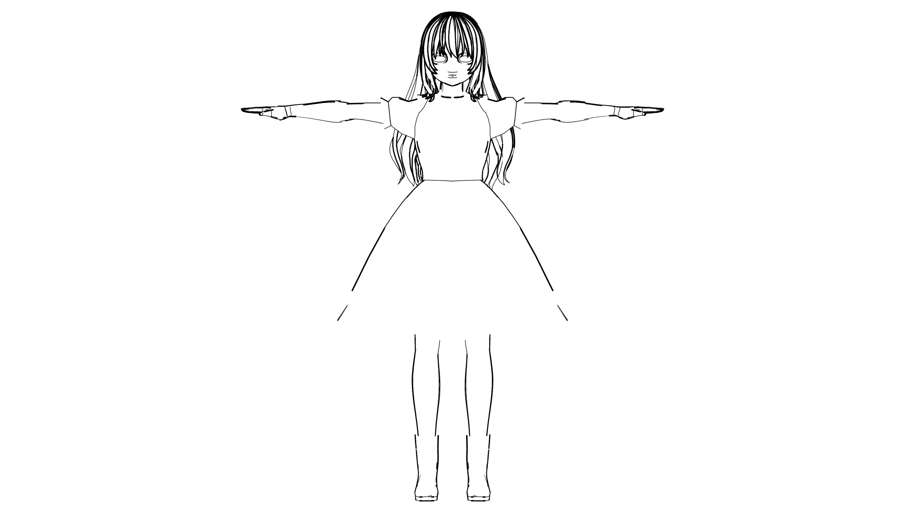

# LineForge

**CPU line-art renderer for Blender 5.2** — silhouette, crease, mesh-border, material-boundary and
object-intersection lines rasterised into a transparent line pass you composite over EEVEE / Cycles.
GPL-2.0-or-later.

---

## Getting started

| I want to… | Read |
|---|---|
| Install it and render my first line pass | **[中文使用教程](TUTORIAL.zh.md)** · [English tutorial](TUTORIAL.md) |
| Know what the five line types mean | tutorial §4 |
| Tune a specific look (cel, sketch, x-ray, AOV) | tutorial §5–§7 |
| Fix "no lines" / ghost outlines / wrong colours | tutorial §9 (zh) · §8 (en) |
| Download the add-on | [latest release](https://github.com/Toobe53/lineforge/releases/latest) |
| Build the native core myself | [README → Build](https://github.com/Toobe53/lineforge/blob/main/README.md#build) |

---

## What it does

* **Five line types** from real geometry, not screen-space filters: silhouette, crease, mesh border,
  material boundary, object intersection.
* **Per-line-set styling**: width (screen or world space), colour, taper, random width, distance fade,
  brush presets, dash/dot patterns, procedural charcoal/pencil/ink textures, image brush profiles.
* **Occlusion-aware**: depth-tested capsules, optional hidden-line pass, backface-culled depth buffer.
* **AOV output**: line pass, hidden pass and linear depth pass, saved as PNG/EXR for compositing.
* **Hair curves**: Blender 5.2 `CURVES` drawn from their own radius, no triangulation.
* **Handles real assets**: skips see-through faces and inverted-hull outline shells, per-line-set
  object/material filters, animation-aware geometry cache.
* **Portable**: one zip per release with `bin/<platform>/`; Windows x64 prebuilt, Linux/macOS build from
  source with `tools/build.py` or CMake; CI builds all three.

## Performance

1920×1080, 70,794 triangles, 4 line sets, supersampling 2: **≈0.40 s** core time
(depth 230 ms / strokes 50 ms / composite 116 ms), ≈2.4 s including depsgraph extraction.

## Licence

GPL-2.0-or-later — commercial use and modification are allowed; distributed derivatives must stay open.
